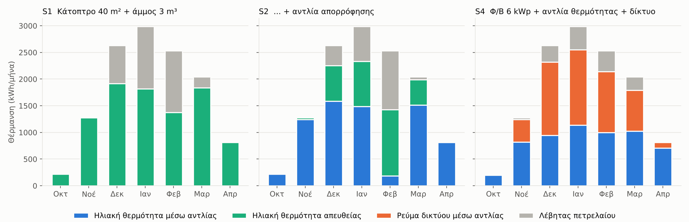
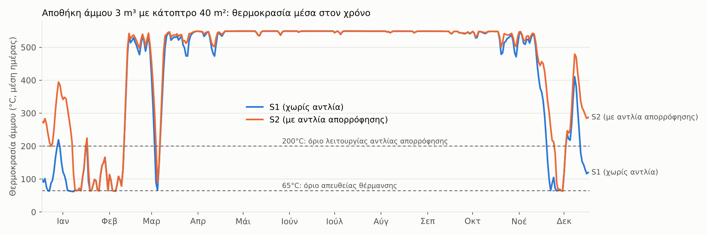
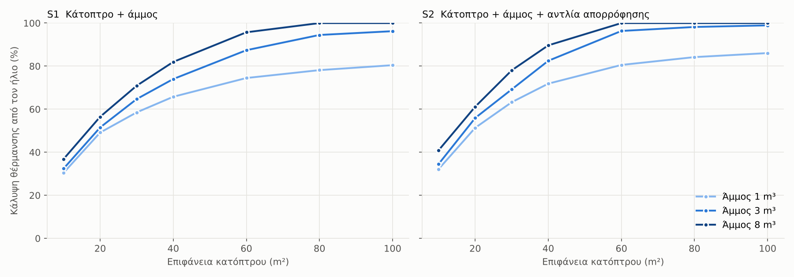
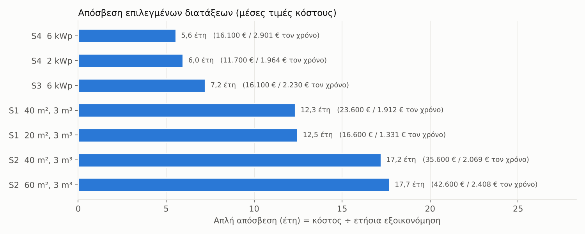

# Ηλιακή θέρμανση με θερμική αποθήκη: αποτελέσματα προσομοίωσης

Ωριαία προσομοίωση ενός έτους (8.760 ώρες) για σπίτι 100 m² στην Κόρινθο. Καιρός: συνθετικό τυπικό έτος. Τρέχει με `python3 sim.py`.

## Τι βγήκε, με μια ματιά

- **Σήμερα:** η θέρμανση (χωρίς το ζεστό νερό) κοστίζει ~2.583 €/έτος (~1.667 L πετρέλαιο).
- **Κάτοπτρο 40 m² + άμμος 3 m³ (S1)** καλύπτει **74%** της θέρμανσης. Με την **αντλία απορρόφησης (S2)** φτάνει **82%**.
- **Ο καταρράκτης δουλεύει, αλλά λιγότερο απ' όσο υπολόγισα στη συζήτηση.** Κάθε kWh που βγαίνει από την άμμο γίνεται ~1,31 kWh θέρμανσης (όχι ~1,4 που είχα πει). Όμως η αποθήκη μένει πιο ζεστή, οπότε το κάτοπτρο μαζεύει λιγότερο (10.621 αντί για 11.884 kWh/έτος). Το καθαρό κέρδος είναι +8 μονάδες κάλυψης, για ~12.000 € επιπλέον κόστος.
- **Φ/Β + ηλεκτρική αντλία θερμότητας + δίκτυο (S4)** καλύπτει ~89% χωρίς λέβητα και αποσβένεται σε **~5,6 χρόνια**, έναντι **~12,3** για το S1 και **~17,2** για το S2. Ακόμα και με μόλις 2 kWp: ~6,0 χρόνια.
- **Συμπέρασμα:** ως οικονομική επένδυση κερδίζει καθαρά η ηλεκτρική αντλία θερμότητας. Το κάτοπτρο με την άμμο δουλεύει τεχνικά (74–82% κάλυψη) και έχει νόημα αν μετράει η ενεργειακή αυτονομία ή ως πειραματικό project. Η αντλία απορρόφησης δεν αξίζει το κόστος της με αυτή την αποθήκη.

## 1. Από πού έρχεται η θέρμανση κάθε μήνα

| Μήνας | Ανάγκη (kWh) | S1 ήλιος | S1 λέβητας | S2 ήλιος | S2 λέβητας | S4 Φ/Β | S4 δίκτυο | S4 λέβητας |
|---|---|---|---|---|---|---|---|---|
| Οκτ | 217 | 217 | 0 | 217 | 0 | 202 | 15 | 0 |
| Νοέ | 1.277 | 1.277 | 0 | 1.277 | 0 | 822 | 419 | 37 |
| Δεκ | 2.631 | 1.918 | 713 | 2.251 | 380 | 943 | 1.375 | 313 |
| Ιαν | 2.987 | 1.815 | 1.172 | 2.335 | 652 | 1.141 | 1.412 | 434 |
| Φεβ | 2.529 | 1.373 | 1.156 | 1.426 | 1.103 | 997 | 1.147 | 386 |
| Μαρ | 2.043 | 1.836 | 207 | 1.988 | 55 | 1.028 | 764 | 252 |
| Απρ | 816 | 816 | 0 | 816 | 0 | 706 | 108 | 1 |

Ο Δεκέμβριος και ο Ιανουάριος είναι το «στενό»: λίγος ήλιος, μεγάλη ανάγκη. Τον Οκτώβριο, τον Μάρτιο και τον Απρίλιο ο ήλιος περισσεύει.

## 2. Τι κάνει η αποθήκη μέσα στον χρόνο

- Από τον Μάιο έως τον Σεπτέμβριο η άμμος μένει γεμάτη (550°C) και το κάτοπτρο απλώς αναπληρώνει τις απώλειες. Ο χειμώνας ξεκινά με **γεμάτη μπαταρία**.
- Απώλειες αποθήκης με μόνωση κενού: ~2.633 kWh/έτος (~7,2 kWh/ημέρα).
- Τον Δεκέμβριο και τον Ιανουάριο η άμμος αδειάζει σε σειρές συννεφιασμένων ημερών και ξαναγεμίζει στις ηλιόλουστες. Εκεί δουλεύει ο λέβητας.

## 3. Πόσο κάτοπτρο και πόση άμμος

| Κάτοπτρο | Άμμος 1 m³ | Άμμος 3 m³ | Άμμος 8 m³ | με απορρόφηση, 3 m³ |
|---|---|---|---|---|
| 10 m² | 30% | 32% | 37% | 35% |
| 20 m² | 49% | 52% | 56% | 56% |
| 30 m² | 59% | 65% | 71% | 69% |
| 40 m² | 66% | 74% | 82% | 82% |
| 60 m² | 74% | 87% | 96% | 96% |
| 80 m² | 78% | 94% | 100% | 98% |
| 100 m² | 80% | 96% | 100% | 99% |

- Μέχρι ~40 m² κάθε επιπλέον m² κατόπτρου προσθέτει πολλά. Μετά, η απόδοση φθίνει.
- Μεγαλύτερη αποθήκη από ~3 m³ προσθέτει λίγο: ο περιορισμός είναι **το κάτοπτρο τον χειμώνα**, όχι η αποθήκη.
- Ενδεικτικά, 40 m² είναι ένας δίσκος διαμέτρου ~7 m, ή π.χ. 4 δίσκοι των ~3,5 m.

## 4. Οικονομικά

| Διάταξη | Κάλυψη χωρίς λέβητα | Πετρέλαιο που μένει | Εξοικονόμηση θέρμανσης | + Φ/Β εκτός θέρμανσης | Κόστος | Απόσβεση |
|---|---|---|---|---|---|---|
| S4 Φ/Β+αντλία θερμ.+δίκτυο 2 kWp | 89% | 190 L | 1.687 € | 276 € | 11.700 € | 6,0 έτη |
| S4 Φ/Β+αντλία θερμ.+δίκτυο 6 kWp | 89% | 190 L | 1.877 € | 1.023 € | 16.100 € | 5,6 έτη |
| S3 Φ/Β+αντλία θερμ. 6 kWp | 47% | 888 L | 1.207 € | 1.023 € | 16.100 € | 7,2 έτη |
| S1 κάτοπτρο+άμμος 20 m², 3 m³ | 52% | 808 L | 1.331 € | 0 € | 16.600 € | 12,5 έτη |
| S1 κάτοπτρο+άμμος 40 m², 3 m³ | 74% | 433 L | 1.912 € | 0 € | 23.600 € | 12,3 έτη |
| S2 κάτοπτρο+άμμος+απορρόφηση 40 m², 3 m³ | 82% | 292 L | 2.069 € | 0 € | 35.600 € | 17,2 έτη |
| S2 κάτοπτρο+άμμος+απορρόφηση 60 m², 3 m³ | 96% | 61 L | 2.408 € | 0 € | 42.600 € | 17,7 έτη |

Το «Φ/Β εκτός θέρμανσης» είναι η αξία του ηλιακού ρεύματος που δεν πάει στη θέρμανση (καλοκαίρι, συσκευές), με 0,15 €/kWh. Το κάτοπτρο δεν έχει αντίστοιχο όφελος στο μοντέλο, αν και στην πράξη η αντλία απορρόφησης του S2 θα μπορούσε να κάνει και **ψύξη** το καλοκαίρι.

## 5. Πόσο αξιόπιστα είναι τα νούμερα (ευαισθησία)

Κάτοπτρο 40 m², άμμος 3 m³:

| Σενάριο | S1 κάλυψη | S1 εξοικ./έτος | S2 κάλυψη | S2 εξοικ./έτος |
|---|---|---|---|---|
| Βασικό σενάριο | 74% | 1.912 € | 82% | 2.069 € |
| Πιο απλό κάτοπτρο (οπτική 0,55, συγκέντρωση ×100) | 60% | 1.560 € | 64% | 1.610 € |
| Μόνωση πετροβάμβακα 30 cm αντί για κενό | 65% | 1.689 € | 69% | 1.733 € |
| Χωρίς διόρθωση άμεσης ακτινοβολίας (+11%) | 78% | 2.022 € | 87% | 2.182 € |

Απόσβεση (έτη) ανάλογα με την τιμή του πετρελαίου:

| Πετρέλαιο | S1 40 m² | S2 40 m² | S4 6 kWp |
|---|---|---|---|
| 1,20 €/L | 15,9 | 22,4 | 6,8 |
| 1,55 €/L | 12,3 | 17,2 | 5,6 |
| 1,90 €/L | 10,1 | 14,0 | 4,7 |

**Το πιο ευαίσθητο σημείο είναι το κάτοπτρο:** ένα απλούστερο, χειροποίητο κάτοπτρο με χαμηλότερη συγκέντρωση χάνει σημαντικό μέρος της απόδοσης στους 500°C. Η μόνωση κενού έναντι πετροβάμβακα επίσης μετράει.

## 6. Παραδοχές και όρια του μοντέλου

**Σπίτι:** 12.500 kWh θέρμανσης/έτος (2.000 L × 10 kWh × 0,75 απόδοση λέβητα, μείον ~2.500 kWh για ζεστό νερό, που πλέον το καλύπτει ο ηλιακός θερμοσίφωνας). Περίοδος Οκτώβριος–Απρίλιος. Ζήτηση ανάλογη της διαφοράς από τους 17°C.

**Καιρός:** συνθετικό τυπικό έτος, βαθμονομημένο σε τυπικές μηνιαίες τιμές ακτινοβολίας και θερμοκρασίας της περιοχής, με τυχαίες σειρές ηλιόλουστων και συννεφιασμένων ημερών. Η άμεση ακτινοβολία έχει μειωθεί 10% συντηρητικά (ετήσια ~1.810 kWh/m²). **Δεν είναι μετρήσεις για το σημείο σου.** Για ακριβέστερα αποτελέσματα κατέβασε από το [PVGIS](https://re.jrc.ec.europa.eu/pvg_tools/en/) → *TMY* → *csv* για τη θέση του σπιτιού και τρέξε `python3 sim.py --pvgis tmy.csv`.

**Κάτοπτρο:** σημειακής εστίασης με παρακολούθηση 2 αξόνων, οπτική απόδοση 0,70, συγκέντρωση ×300, δέκτης-κοιλότητα. Η απόδοση πέφτει όσο ανεβαίνει η θερμοκρασία (απώλειες ακτινοβολίας ∝ T⁴). Δεν λειτουργεί κάτω από 150 W/m² άμεσης ακτινοβολίας.

**Αποθήκη:** κύλινδρος άμμου έξω από το σπίτι, μέγιστο 550°C, μόνωση κενού με περλίτη 20 cm (+25% για θερμογέφυρες). Οι απώλειες χάνονται (δεν ζεσταίνουν το σπίτι).

**Αντλία απορρόφησης (S2):** τύπου αμμωνίας-νερού, απόδοση 1,25–1,70 ανάλογα με την εξωτερική θερμοκρασία, λειτουργεί όσο η άμμος είναι πάνω από 200°C, +4% ρεύμα για βοηθητικά.

**Καλοριφέρ:** τα υπάρχοντα, σχεδιασμένα για 80/60°C. Στους 55°C (που δίνουν οι αντλίες θερμότητας) αποδίδουν ~50% της ισχύος τους. Ό,τι ξεπερνά αυτό το όριο το καλύπτει ο λέβητας, ή απευθείας η άμμος στο S1/S2, που μπορεί να δώσει νερό υψηλής θερμοκρασίας.

**Φ/Β + αντλία θερμότητας (S3/S4):** νότια κλίση 30°, συντελεστής απόδοσης 0,82. Ηλεκτρική αντλία αέρα-νερού 10 kW, απόδοση 1,8–4,0 ανάλογα με την εξωτερική θερμοκρασία. Η παλιά δεξαμενή 1 m³ ως buffer στους 40–60°C.

**Τιμές:** πετρέλαιο 1,55 €/L, ρεύμα 0,22 €/kWh. **Κόστη εγκατάστασης (μέσες εκτιμήσεις, μεγάλη αβεβαιότητα):** κάτοπτρο 350 €/m², αποθήκη 3.000 € + 1.200 €/m³, κύκλωμα αέρα και αυτοματισμοί 3.000 €, αντλία απορρόφησης με προσαρμογή 12.000 €. Φ/Β 1.100 €/kWp + 1.000 €, ηλεκτρική αντλία θερμότητας 7.000 €, μετατροπή δεξαμενής 1.500 €. Χωρίς επιδοτήσεις.

**Τι ΔΕΝ μοντελοποιείται:** σκιάσεις, χιόνι ή σκόνη στο κάτοπτρο, βλάβες και συντήρηση, χρόνος προθέρμανσης του κατόπτρου, έξυπνος έλεγχος με πρόγνωση καιρού, ψύξη το καλοκαίρι, άδειες. Τα αποτελέσματα είναι **για σύγκριση διατάξεων**, όχι εγγυημένες αποδόσεις.

## Αρχεία

- `sim.py`: το μοντέλο. Όλες οι παράμετροι είναι στην αρχή του αρχείου (λεξικό `P`).
- `report.py`: παράγει αυτή την αναφορά, τα γραφήματα και το Excel.
- `apotelesmata.xlsx`: όλα τα σενάρια (82 διατάξεις), οι παράμετροι και ο καιρός ανά μήνα.
- `1_ana_mina.png`, `2_thermokrasia_ammou.png`, `3_megethos.png`, `4_aposvesi.png`: τα γραφήματα.
