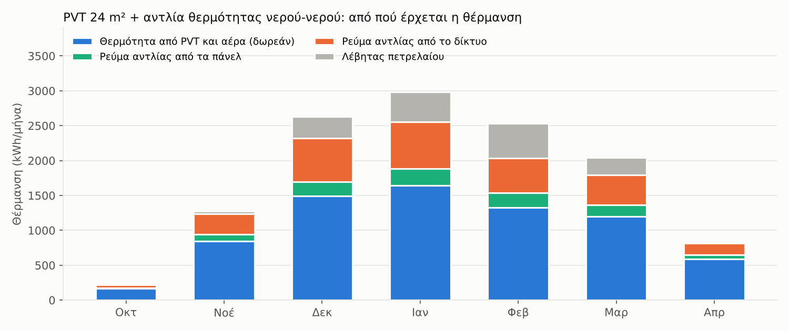

# PVT στην ταράτσα: απόδοση, υλικά, κόστος και σύγκριση

Ωριαία προσομοίωση ενός έτους για το σπίτι στην Κόρινθο (ίδιος καιρός και ίδια ζήτηση με το `sim.py`). Τρέχει με `python3 pvt_report.py`.

## Το σύστημα

```
  ΤΑΡΑΤΣΑ  12 πάνελ PVT (~24 m², 5,2 kWp, κλίση 40°)
           κοινό πάνελ + κυψελωτό πολυκαρβονικό στην πλάτη + λεπτή σιλικόνη
           πλάτη ΧΩΡΙΣ μόνωση: μαζεύει ήλιο ΚΑΙ θερμότητα από τον αέρα (και τη νύχτα)
        │ ρεύμα                       │ γλυκόλη 0-35°C
        ▼                             ▼
   inverter → σπίτι / δίκτυο    ΠΑΛΙΑ ΔΕΞΑΜΕΝΗ 1 m³ = δεξαμενή-ΠΗΓΗ (νερό, ή πάγος)
        │                             │
        └──── ρεύμα ────►  ΑΝΤΛΙΑ ΘΕΡΜΟΤΗΤΑΣ νερού-νερού ~8 kW  (COP ~2,6-4,5)
                                      ▼
                          buffer 300 L, 55°C → λέβητας σε σειρά (μόνο ενίσχυση) → καλοριφέρ
```

## 1. Απόδοση

Σήμερα η θέρμανση χώρου κοστίζει ~2.583 €/έτος (~1.667 L πετρέλαιο).

| PVT | Ρεύμα από τα πάνελ | Θερμότητα από τα πάνελ | Θέρμανση από την αντλία | Πετρέλαιο που μένει | Ρεύμα δικτύου για την αντλία | Εξοικονόμηση θέρμανσης | + αξία υπόλοιπου ρεύματος |
|---|---|---|---|---|---|---|---|
| 10 m² (2,1 kWp) | 3.176 kWh | 6.152 kWh | 9.512 kWh (**76%**) | 398 L | 2.678 kWh | 1.377 € | 372 € |
| 16 m² (3,4 kWp) | 5.050 kWh | 6.976 kWh | 10.637 kWh (**85%**) | 248 L | 2.807 kWh | 1.581 € | 626 € |
| 24 m² (5,2 kWp) | 7.539 kWh | 7.301 kWh | 10.972 kWh (**88%**) | 204 L | 2.715 kWh | 1.670 € | 983 € |



| Μήνας | Ανάγκη | Δωρεάν (PVT + αέρας) | Ρεύμα από πάνελ | Ρεύμα δικτύου | Λέβητας |
|---|---|---|---|---|---|
| Οκτ | 217 | 168 | 7 | 41 | 0 |
| Νοέ | 1.277 | 846 | 99 | 295 | 37 |
| Δεκ | 2.631 | 1.493 | 203 | 623 | 313 |
| Ιαν | 2.987 | 1.646 | 240 | 667 | 434 |
| Φεβ | 2.529 | 1.330 | 206 | 502 | 491 |
| Μαρ | 2.043 | 1.199 | 170 | 423 | 252 |
| Απρ | 816 | 590 | 60 | 165 | 1 |

- Η παλιά δεξαμενή **παγώνει μερικώς ~886 ώρες τον χρόνο** (σε σειρές κρύων ημερών). Είναι φυσιολογικό, και ο πάγος δίνει θερμότητα (~93 kWh ανά m³).
- **Η πλάτη χωρίς μόνωση μετράει:** με μονωμένη πλάτη τα πάνελ μαζεύουν μόνο ήλιο και η κάλυψη πέφτει στο 85% (από 88%). Ως πηγή για αντλία θερμότητας θέλουμε τα πάνελ να «ανταλλάσσουν» και με τον αέρα.
- Το μεγαλύτερο μέρος της θέρμανσης έρχεται **δωρεάν** από τα πάνελ και τον αέρα. Το ρεύμα της αντλίας είναι ~1/3.

### Μια διόρθωση σε κάτι που είχα πει

Είχα εκτιμήσει ότι το PVT παίρνει ~20–30% περισσότερη ενέργεια από απλά φωτοβολταϊκά με αντλία αέρα. **Η προσομοίωση για την Κόρινθο δεν το επιβεβαιώνει.** Με ίδια ισχύ πάνελ (5,2 kWp), τα απλά φωτοβολταϊκά με αντλία αέρα-νερού εξοικονομούν ~2.690 €/έτος και το PVT ~2.653 €/έτος, δηλαδή **πρακτικά το ίδιο**. Ο λόγος: ο χειμώνας στην Κόρινθο είναι ήπιος, με αέρα συνήθως ~8–14°C, ενώ μια μικρή δεξαμενή-πηγή πέφτει συχνά κοντά στους 0°C όταν η αντλία τραβάει πολύ τα βράδια. Ο αέρας είναι ήδη καλή πηγή. Το PVT κερδίζει σε κρύα κλίματα, ή με πολύ μεγαλύτερη δεξαμενή-πηγή.

## 2. Λίστα υλικών και κόστος

### Φάση 1: πιλοτικό (αυτόν τον χειμώνα)

| Υλικό | Ενδεικτικό κόστος |
|---|---|
| 2 φωτοβολταϊκά πάνελ ~430 W (ένα PVT, ένα για σύγκριση) | 240 € |
| Κυψελωτό πολυκαρβονικό 10 mm, 1 φύλλο | 35 € |
| Σωλήνες-συλλέκτες PP/CPVC, τάπες, ρακόρ | 30 € |
| Σιλικόνη ουδέτερου τύπου (2 φυσίγγια) + οδοντωτή σπάτουλα | 25 € |
| Κυκλοφορητής 12 V DC + φωτοβολταϊκό 30 W για την αντλία | 90 € |
| Σωληνάκια, κολάρα, γλυκόλη ~10 L | 70 € |
| Δοχείο 100-200 L μονωμένο (ή η παλιά δεξαμενή) | 70 € |
| 4-6 ψηφιακά θερμόμετρα / αισθητήρες με καταγραφή | 50 € |
| 2 μετρητές ισχύος DC + φορτίο (ρυθμιστής MPPT και μικρή μπαταρία ή αντιστάσεις) | 120 € |
| Βάσεις και βαρίδια ταράτσας, ιμάντες | 70 € |
| **Σύνολο** | **~800 €** |

Το φωτοβολταϊκό πρέπει να έχει **φορτίο** για να μετρηθεί η ισχύς του, π.χ. ρυθμιστή MPPT με μικρή μπαταρία, ή αντιστάσεις. Τι μετράτε: θερμοκρασία πάνελ (PVT και σύγκρισης), ισχύ των δύο πάνελ, θερμοκρασία νερού στην είσοδο, στην έξοδο και στη δεξαμενή, θερμοκρασία αέρα.

### Φάση 2: πλήρες σύστημα DIY, 24 m²

| Υλικό / εργασία | Ενδεικτικό κόστος |
|---|---|
| 12 φωτοβολταϊκά ~430 W (5,2 kWp, ~24 m²) | 1.320 € |
| Κυψελωτό πολυκαρβονικό 10 mm, ~28 m² | 420 € |
| Σωλήνες-συλλέκτες, ρακόρ, σωλήνωση ανάμεσα στα πάνελ | 300 € |
| Σιλικόνη (λεπτό στρώμα) και αναλώσιμα | 200 € |
| Προστατευτικό κάλυμμα πλάτης (χωρίς μόνωση, για να πιάνει και αέρα) | 180 € |
| Βάσεις αλουμινίου με βαρίδια, χωρίς τρύπες στην ταράτσα | 840 € |
| Κύκλωμα γλυκόλης: μονωμένοι σωλήνες προς το ισόγειο, γλυκόλη, κυκλοφορητής, δοχείο διαστολής, ασφαλιστικά | 1.010 € |
| Παλιά δεξαμενή ως δεξαμενή-πηγή: καθαρισμός, σερπαντίνα, μόνωση, αισθητήρες | 750 € |
| Αντλία θερμότητας νερού-νερού ~8 kW με εγκατάσταση | 7.000 € |
| Buffer 300 L, βάνες, σύνδεση με λέβητα σε σειρά, αυτοματισμός | 1.200 € |
| Inverter 5 kW, ηλεκτρολογικά, προστασίες, σύνδεση ΔΕΔΔΗΕ | 1.800 € |
| **Σύνολο DIY** | **~15.020 €** (εύρος ~12.767–18.775 €) |
| Για σύγκριση: εμπορικό PVT με εγκατάσταση | ~22.000–28.000 € |

Η **αντλία θερμότητας** είναι σχεδόν το μισό κόστος. Η απλή απόσβεση του DIY είναι **~5,7 χρόνια**. Χωρίς επιδοτήσεις.

## 3. Σύγκριση με όλα τα σενάρια

| Σύστημα | Κάλυψη χωρίς λέβητα | Πετρέλαιο που μένει | Εξοικονόμηση/έτος | Κόστος | Απόσβεση | Χωράει στο σπίτι σου; | Πολυπλοκότητα |
|---|---|---|---|---|---|---|---|
| **PVT 24 m² + αντλία νερού-νερού (DIY)** | 88% | 204 L | 2.653 € | 15.020 € | 5,7 έτη | Ναι (~24 m², ~25 kg/m²) | Μέτρια-υψηλή (DIY υδραυλικά στην ταράτσα) |
| PVT 24 m², εμπορικό, με εγκατάσταση | 88% | 204 L | 2.653 € | 25.000 € | 9,4 έτη | Ναι | Χαμηλή για εσένα (τα κάνει ο εγκαταστάτης) |
| Φ/Β 5,2 kWp + αντλία αέρα-νερού + δίκτυο (σαν το S4) | 89% | 190 L | 2.690 € | 15.220 € | 5,7 έτη | Ναι (~24 m², ~15 kg/m²) | Χαμηλή (έτοιμα προϊόντα) |
| S4 του GitHub: Φ/Β 6 kWp + αντλία αέρα-νερού + δίκτυο | 89% | 190 L | 2.901 € | 16.100 € | 5,6 έτη | Ναι (~28 m²) | Χαμηλή |
| S3 του GitHub: Φ/Β 6 kWp + αντλία, μόνο ηλιακό ρεύμα | 47% | 888 L | 2.230 € | 16.100 € | 7,2 έτη | Ναι | Χαμηλή |
| Σωλήνες κενού 25 m² + νερό 2 m³ (taratsa_sim) | 38% | 1.025 L | 981 € | 11.000 € | 11,2 έτη | Ναι | Μέτρια |
| S1 του GitHub: κάτοπτρο 40 m² + άμμος 3 m³ | 74% | 433 L | 1.912 € | 23.600 € | 12,3 έτη | **Όχι**: θέλει ηλιόλουστο έδαφος, που δεν υπάρχει | Πολύ υψηλή |
| S2 του GitHub: + αντλία απορρόφησης | 82% | 292 L | 2.069 € | 35.600 € | 17,2 έτη | **Όχι** | Πολύ υψηλή |

Η «εξοικονόμηση» στα σενάρια με φωτοβολταϊκά περιλαμβάνει την αξία του ρεύματος που δεν πάει στη θέρμανση (0,15 €/kWh).

## 4. Συμπέρασμα

- **Τα κάτοπτρα με την άμμο (S1/S2) βγαίνουν εκτός:** χρειάζονται ηλιόλουστο έδαφος ή αντοχή σε τόνους, και το σπίτι δεν έχει κανένα από τα δύο.
- **Το PVT δουλεύει καλά:** καλύπτει ~85–90% της θέρμανσης με 24 m² στην ταράτσα και αξιοποιεί την παλιά δεξαμενή.
- **Οικονομικά είναι ισόπαλο με απλά φωτοβολταϊκά και αντλία αέρα-νερού, αν το φτιάξεις DIY.** Αν το αγοράσεις εμπορικό, είναι ακριβότερο.
- **Πλεονεκτήματα PVT:** καμία εξωτερική μονάδα, αθόρυβο, χρησιμοποιεί την παλιά δεξαμενή, και είναι **το δικό σου project** με τον γείτονα.
- **Πλεονεκτήματα απλών Φ/Β + αντλίας αέρα:** έτοιμα προϊόντα με εγγύηση, λιγότερα υδραυλικά στην ταράτσα, λιγότερα σημεία βλάβης.
- **Και στα δύο, πρώτα το πιλοτικό** (~800 €), και η απόφαση την άνοιξη, με μετρήσεις και με τον ιδιοκτήτη.

## Παραδοχές

PVT χωρίς τζάμι μπροστά: 215 W/m² ρεύμα (STC), απώλεια −0,4%/°C, θερμική απόδοση 0,50, ανταλλαγή με τον αέρα 25 W/m²K (πλάτη χωρίς μόνωση), απώλεια προς τον ουρανό 35 W/m² τη νύχτα. Δεξαμενή-πηγή 1 m³, 0–35°C, μπορεί να παγώσει έως 85%. Αντλία νερού-νερού 8 kW, COP = 0,48 × Carnot για νερό 55°C. Καλοριφέρ στους 55°C: ~50% της ισχύος τους (το υπόλοιπο ο λέβητας). Πετρέλαιο 1,55 €/L, λέβητας 75%, ρεύμα 0,22 €/kWh. Συνθετικός καιρός (βλ. ANAFORA.md). Δεν μοντελοποιούνται: σκόνη, χιόνι, βλάβες, έξυπνος έλεγχος με πρόγνωση.
